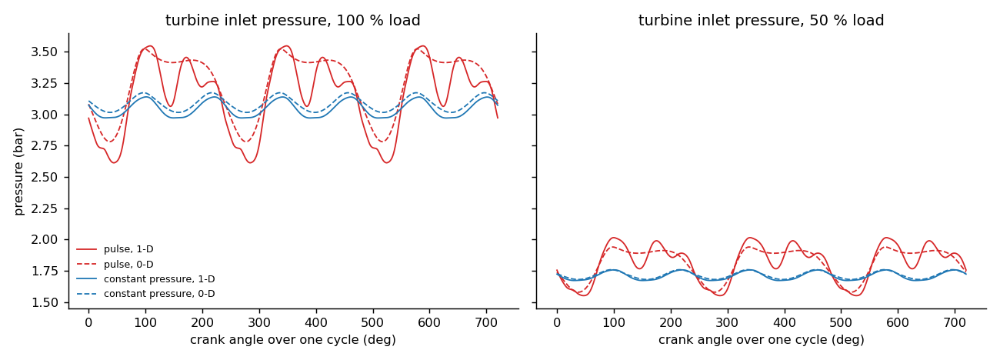
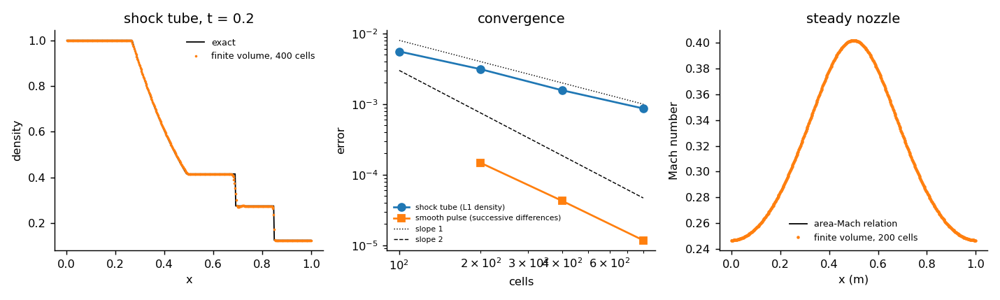
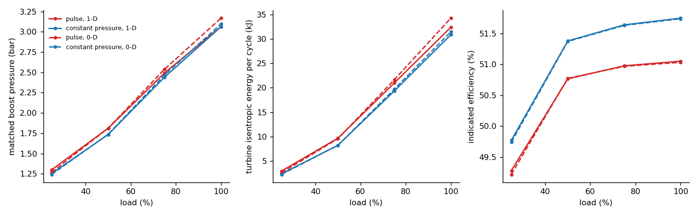
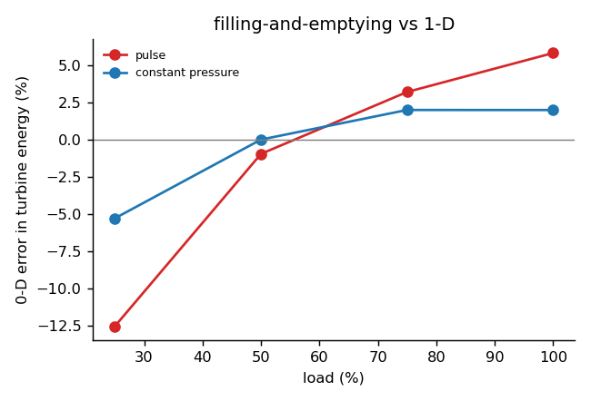
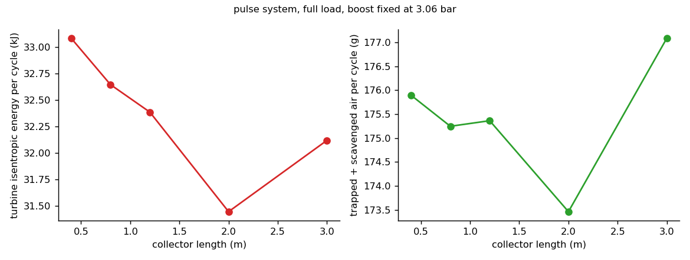

# Exhaust-Pulse Gas Dynamics & 0D/1D Turbocharging Model

A small GT-Power-style engine simulation tool written from scratch: 1-D unsteady gas dynamics in the exhaust
manifold, 0-D cylinders with valves, combustion and wall heat transfer, and a turbocharger whose turbine and
compressor are matched cycle by cycle. It is used to answer two questions that matter in turbocharger matching:

1. **Pulse or constant-pressure turbocharging?** For a 6-cylinder medium-speed engine, how much turbine energy, boost
   and efficiency does each exhaust layout give across the load range?
2. **When can a 0-D (filling-and-emptying) manifold model be trusted?** How large is its error compared with the
   1-D wave model, and where does it come from?

## In short

| Result | Number |
|---|---|
| Boost with pulse vs constant-pressure turbocharging | **+3.7 % at 25 % load, +4.4 % at 50 %**, +2.2 % at 75 %, equal at full load (3.06 bar) |
| Isentropic energy reaching the turbine, pulse vs constant pressure | +24 % at 25 % load, +4.9 % at full load |
| Price of pulse charging | higher exhaust back-pressure during the exhaust stroke: pumping loss 0.51 vs 0.26 bar at full load, **0.5-0.7 points lower indicated efficiency** at every load |
| 0-D manifold model error in turbine energy (vs 1-D) | pulse: **-12.5 % at 25 % load, +5.8 % at full load**; constant pressure: -5.3 % to +2.0 % |
| Conservation | mass and energy of the whole engine closed to 2e-14 per cycle; every operating point matched to 0.3 % |

The pulse system wins at part load (more boost and air) and needs about 1.4 % more fuel for the same work at full load; this is the
classic reason why large medium-speed engines that run mostly at high load use constant-pressure systems, and why
pulse or pulse-converter systems are used where part-load and transient response matter. The 0-D model gets the
time-averaged picture right for a large constant-pressure manifold, but it cannot represent the pressure waves in a
pulse system, so its turbine energy is wrong by up to 12 % in exactly the regime where pulse charging is chosen.



## Model

**Engine** (representative of a 20/28 cm bore/stroke, 1000 rpm generating-set engine, not a specific product): six
cylinders, compression ratio 15, two exhaust and two intake valves per cylinder (sin^2 lift, discharge coefficient
0.65), exhaust opening 50 deg before BDC, 80 deg valve overlap. Single-zone cylinders with a Wiebe heat release
(start 8 deg before TDC, 60 deg duration) and Woschni wall heat transfer. One ideal gas (gamma = 1.35, R = 287 J/kg/K).

**Exhaust layouts** (same engine, same turbine swallowing capacity):
* *pulse*: two groups of three cylinders firing 240 deg apart; 0.6 m x 80 mm branches into a small junction, 1.2 m x
  110 mm collector to each entry of a twin-entry turbine;
* *constant pressure*: six 0.3 m branches into an 80 L manifold, 0.6 m x 160 mm pipe to a single-entry turbine;
* *0-D versions*: every pipe lumped into its downstream volume (filling-and-emptying).

**1-D pipes**: finite volumes, HLLC Riemann fluxes, MUSCL reconstruction with the monotonised-central limiter,
Heun (SSP-RK2) time stepping, wall friction (Darcy f = 0.02) and wall heat transfer (Reynolds-Colburn analogy,
wall at 600 K), area-change source.

**Pipe ends** (valves, junctions, turbine): method of characteristics. The wave arriving from the pipe is kept; the
restriction is the quasi-steady compressible orifice equation. For outflow the face state is isentropic from the
pipe cell; for inflow the incoming gas has the reservoir's entropy, so the wave relation is used in pressure form
(pressure and velocity continuous across the contact) with the reservoir stagnation enthalpy. A closed valve is a
reflecting wall. The same mass and enthalpy flow leaves one side and enters the other, so the network conserves mass
and energy exactly.

**Turbocharger**: turbine = equivalent nozzle (3000 mm^2), efficiency from the instantaneous blade-speed ratio
(peak 80 % at u/c = 0.7), so pulsating flow is penalised where it runs off-design; compressor efficiency 80 %,
work coefficient 0.7, charge-air cooler at 45 degC with 3 kPa pressure drop, mechanical efficiency 97 %. The boost
pressure is found by a secant iteration until eta_mech x turbine work = compressor work over a converged cycle.

## Verification

| Check | Result |
|---|---|
| Shock tube vs exact Riemann solution (written for this project, Toro) | L1 density error 5.6e-3 -> 0.87e-3 on 100-800 cells, order 0.90 (expected about 1 with shocks); mass and energy conserved to round-off |
| Smooth pressure pulse, self-convergence | order 1.86 |
| Steady subsonic nozzle vs isentropic area-Mach relation | max Mach error 5.1e-4 -> 8.5e-6 on 50-400 cells, **order 1.97**; mass flow uniform along the nozzle to 3e-5 |
| Sealed motored cylinder: p V^gamma = const | deviation 5.4e-6 / 1.3e-6 / 3.4e-7 for three time steps, **order 2.00**; first law to 5e-15 |
| Momentum budget of a closed pipe with friction | change in momentum = impulse of wall, friction and area forces to 8e-16 |
| Whole engine, every cycle | mass and energy (fuel heat = piston work + wall heat + enthalpy out - in + storage) closed to 2e-14 |
| Engine mesh convergence (dx = 40 / 20 / 10 mm) | turbine energy 24,550 / 24,547 / 24,545 J; IMEP unchanged to 1e-5 |
| Turbocharger matching | turbine and compressor work balanced to 0.3 % at all 16 points |
| Independent: closed combustion cycle re-solved with scipy `solve_ivp` (own slider-crank, own Wiebe) | peak pressure 125.1867 vs 125.1866 bar; cycle work 16,761.08 J in both |
| Independent: closed p dV integral of a recorded pressure trace vs the energy ledger | 15,422.2 J in both |
| Independent: compressor work of all 16 matched points by hand; peak valve area by hand | within 1.2e-5 (CSV rounding); 4,447.6 mm^2 in both |

The one-gas, single-zone model has no species or momentum balance inside cylinders and volumes (they are lumped);
mass, momentum and energy are balanced in the pipes, and mass and energy in every volume and at every link. 8 automated
tests in `tests/` (exact Riemann star state against Toro's table, HLLC consistency, orifice choking, conservation,
boundary limits, engine geometry, a full-cycle energy balance).



## Results

### Operating line, matched turbocharger

| Load | Boost (bar), pulse / CP | Indicated efficiency, pulse / CP | Pumping loss (bar), pulse / CP | lambda, pulse / CP |
|---|---|---|---|---|
| 25 % | 1.300 / 1.254 | 49.3 % / 49.8 % | 0.20 / 0.16 | 4.60 / 4.32 |
| 50 % | 1.811 / 1.734 | 50.8 % / 51.4 % | 0.24 / 0.13 | 3.41 / 3.15 |
| 75 % | 2.493 / 2.441 | 51.0 % / 51.6 % | 0.37 / 0.19 | 3.13 / 2.95 |
| 100 % | 3.064 / 3.062 | 51.0 % / 51.7 % | 0.51 / 0.26 | 2.87 / 2.74 |

Pumping loss = minus the gas work over the exhaust and intake strokes, as a mean effective pressure
(`-pmep_bar` in `results/matching.csv`). With the assumed turbocharger efficiencies the exhaust pressure stays above
the boost pressure, so both systems pay a pumping loss; the pulse system's pressure peaks during the exhaust stroke
raise it, up to twice the constant-pressure value at full load.



### 0-D vs 1-D



At full load the 0-D pulse model over-predicts turbine energy by 5.8 % and boost by 3.4 %: it spreads each blowdown
over the whole junction-plus-collector volume, so the turbine sees a smoother, slightly higher pressure. At 25 % load
it under-predicts by 12.5 %: there the reflected waves in the 1-D collector raise the pressure during blowdown, which
a lumped volume cannot do. For the constant-pressure layout, whose large manifold really does damp the pulses, the 0-D
error stays within -5.3 % to +2.0 %.

### Collector length (pulse, full load, fixed boost)

| Collector length | 0.4 m | 0.8 m | 1.2 m | 2.0 m | 3.0 m |
|---|---|---|---|---|---|
| Turbine energy per cycle | 33.08 kJ | 32.65 kJ | 32.39 kJ | 31.45 kJ | 32.12 kJ |
| Indicated efficiency | 50.8 % | 50.9 % | 51.1 % | 51.3 % | 51.2 % |

Longer collectors lose turbine energy to wall heat transfer and damping (-5 % from 0.4 to 2.0 m) but relieve the
exhaust stroke; the partial recovery at 3.0 m comes from the timing of the reflected wave. The model resolves this
trade-off; a 0-D model cannot see it at all.



## Limitations

* **No test-bench data.** Validation is against exact solutions and conservation laws; the engine, turbine and
  compressor data are representative values, not measured maps. The natural next step is calibration against
  pressure traces from a test bed.
* One ideal gas (gamma 1.35) for air and burned gas; single-zone combustion; quasi-steady valves and turbine.
* Turbine and compressor are described by an equivalent nozzle and simple efficiency laws instead of measured maps;
  the turbine's own volume and unsteady behaviour are neglected.
* Pipe junctions are lumped volumes rather than 1-D junction models.

## Files

| Path | Content |
|---|---|
| `src/gx/gas.py` | gas relations, orifice flow, HLLC flux, limiters |
| `src/gx/riemann.py` | exact Riemann solver (verification) |
| `src/gx/network.py` | pipes, volumes, characteristic boundary conditions, RK2 integration, energy ledger |
| `src/gx/engine.py` | engine geometry, valves, Wiebe combustion, Woschni heat transfer |
| `src/gx/sim.py` | exhaust layouts, cycle runner, turbocharger matching |
| `scripts/run_verification.py` | all verification cases |
| `scripts/independent_checks.py` | re-implementations used to cross-check the solver (scipy ODE, trace integral, hand calculations) |
| `scripts/run_analysis.py` | operating line, 0-D vs 1-D, collector-length sweep (parallel, about 30 min on 8 cores) |

## Run

```bash
pip install -r requirements.txt
python scripts/run_verification.py
python scripts/run_analysis.py
python scripts/independent_checks.py
python -m pytest -q tests
```
